<p align="center">
  
</p>
<h1 align="center">EPL Sync</h1>

Consulta el catálogo de ePubLibre y gestiona tus descargas y actualizaciones de
libros con qBittorrent y Calibre. Programa sincronizaciones, importaciones del
catálogo y búsquedas de actualizaciones. También puedes automatizar la actualización
de las descargas y de la biblioteca de Calibre.

<table>
  <tr>
    <td align="center" width="33%">
      <a href="docs/media/screenshots/Principal.png">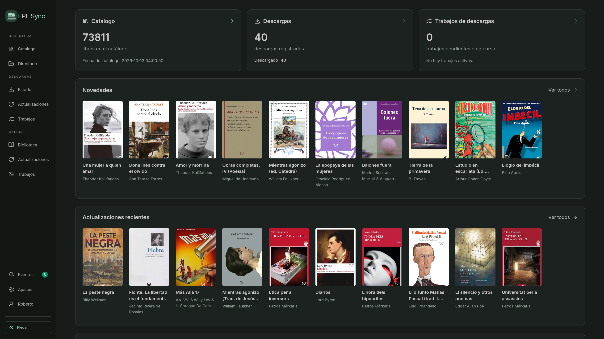</a>
      <br><sub>Pantalla inicial</sub>
    </td>
    <td align="center" width="33%">
      <a href="docs/media/screenshots/Catalogo.png">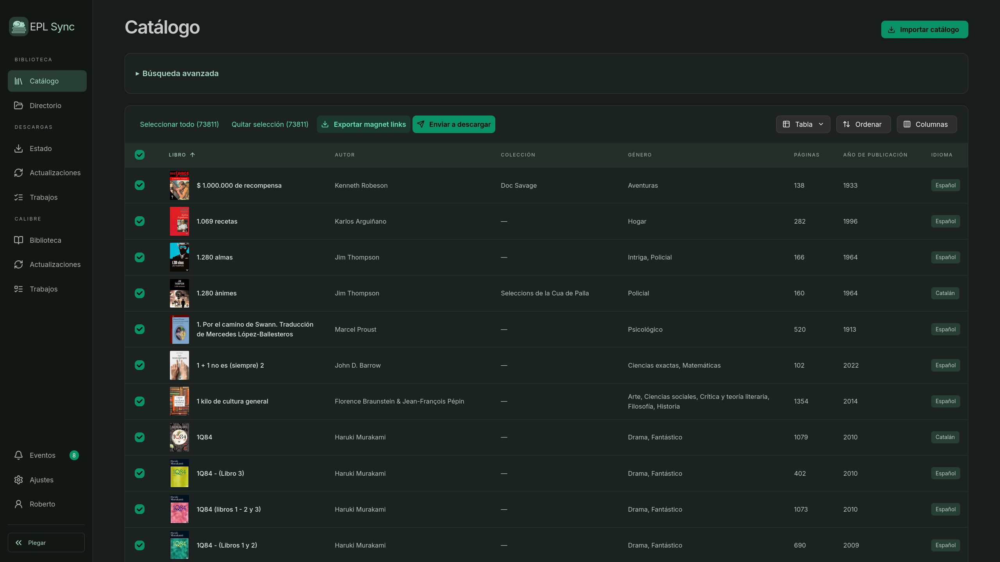</a>
      <br><sub>Catálogo</sub>
    </td>
    <td align="center" width="33%">
      <a href="docs/media/screenshots/Catalogo_BusquedaAvanzada.png">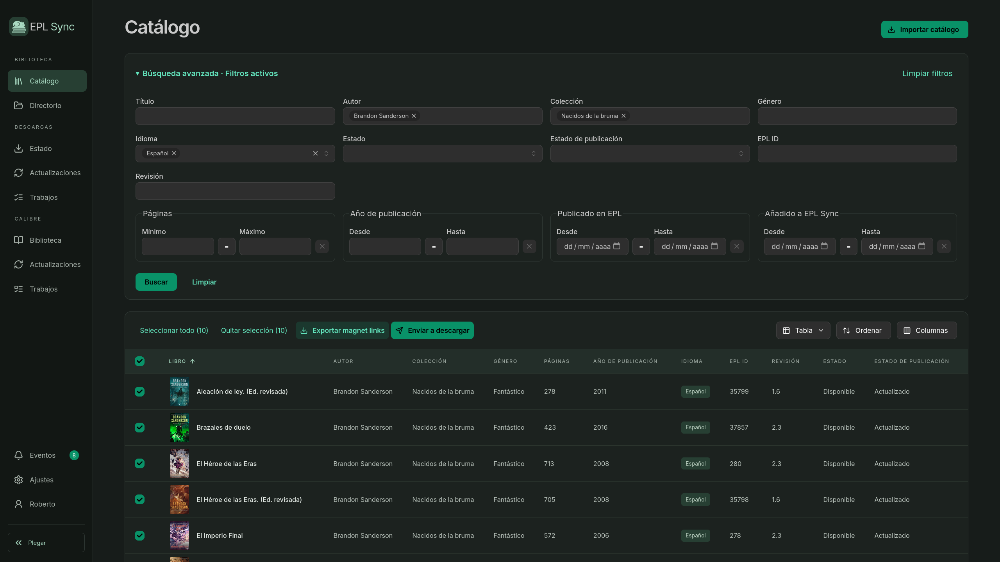</a>
      <br><sub>Búsqueda avanzada</sub>
    </td>
  </tr>
  <tr>
    <td align="center" width="33%">
      <a href="docs/media/screenshots/Catalogo_Libro1.png">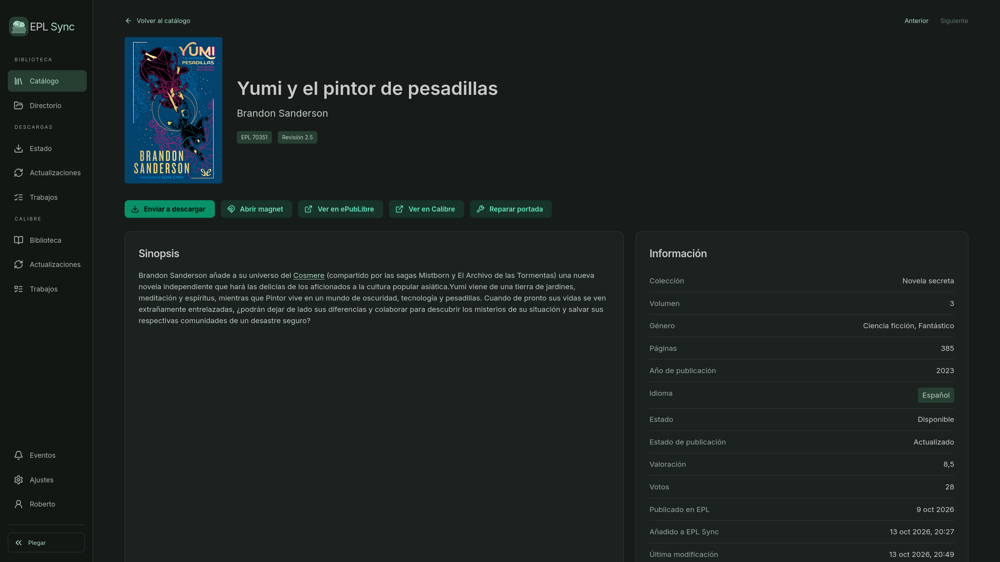</a>
      <br><sub>Ficha del libro</sub>
    </td>
    <td align="center" width="33%">
      <a href="docs/media/screenshots/Catalogo_Libro2.png">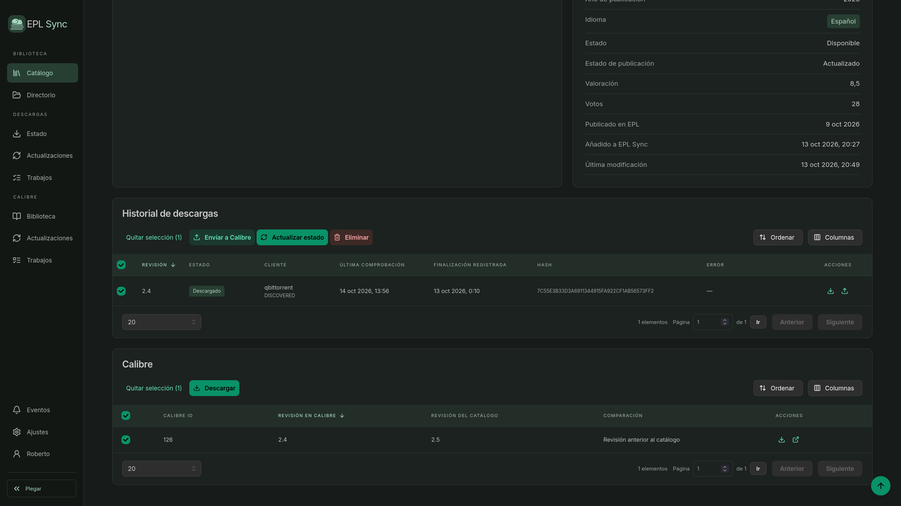</a>
      <br><sub>Ficha del libro · descargas y Calibre</sub>
    </td>
    <td align="center" width="33%">
      <a href="docs/media/screenshots/Directorio_Colecciones.png">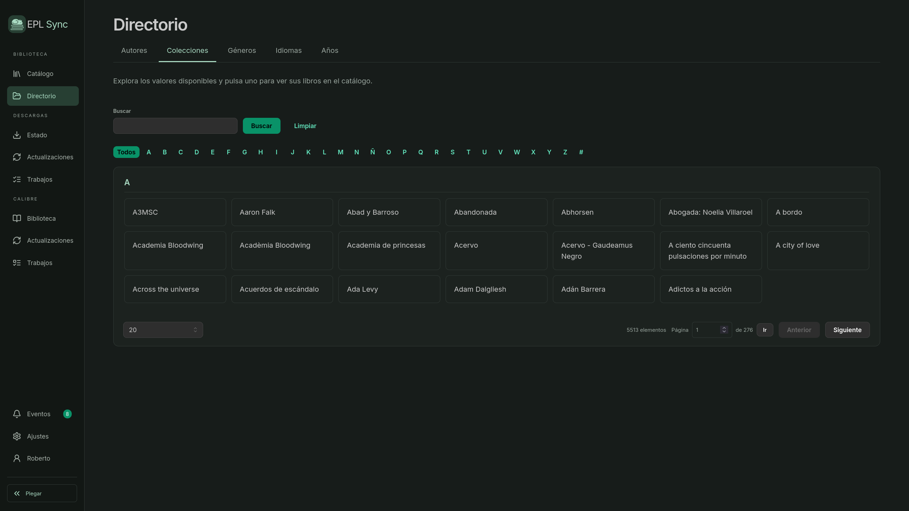</a>
      <br><sub>Directorio de colecciones</sub>
    </td>
  </tr>
  <tr>
    <td align="center" width="33%">
      <a href="docs/media/screenshots/Descargas_Estado.png">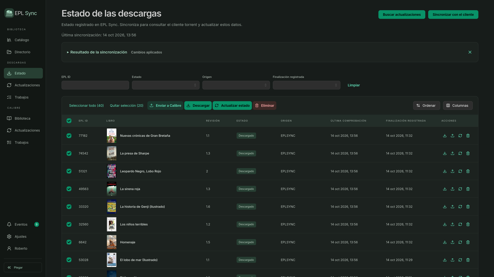</a>
      <br><sub>Estado de las descargas</sub>
    </td>
    <td align="center" width="33%">
      <a href="docs/media/screenshots/Descargas_Actualizaciones.png">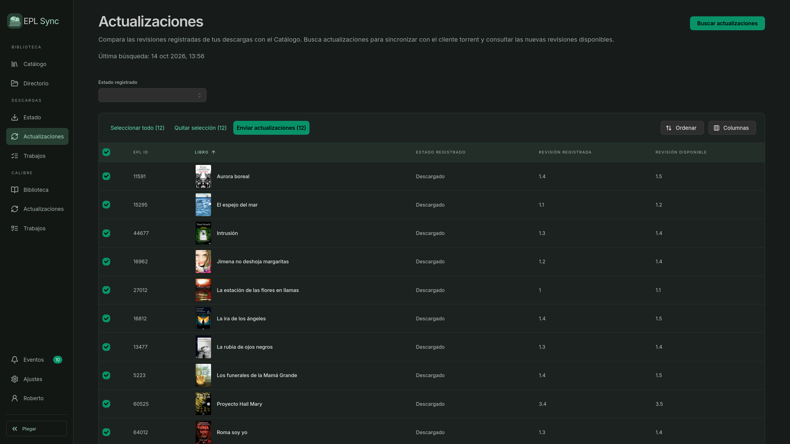</a>
      <br><sub>Actualizaciones de descargas</sub>
    </td>
    <td align="center" width="33%">
      <a href="docs/media/screenshots/Descargas_Trabajos.png">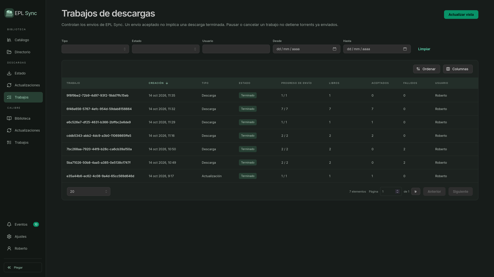</a>
      <br><sub>Trabajos de descargas</sub>
    </td>
  </tr>
  <tr>
    <td align="center" width="33%">
      <a href="docs/media/screenshots/Calibre_Biblioteca.png">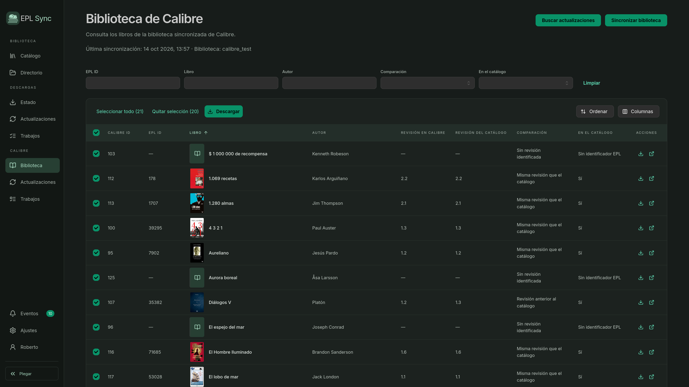</a>
      <br><sub>Biblioteca de Calibre</sub>
    </td>
    <td align="center" width="33%">
      <a href="docs/media/screenshots/Calibre_Actualizaciones.png">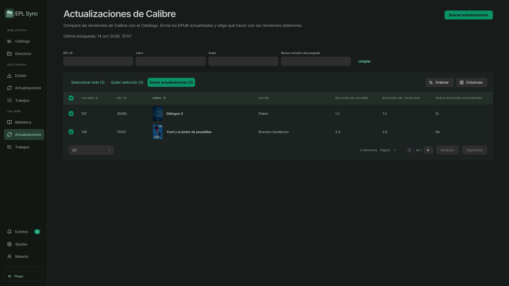</a>
      <br><sub>Actualizaciones de Calibre</sub>
    </td>
    <td align="center" width="33%">
      <a href="docs/media/screenshots/Calibre_Trabajos.png">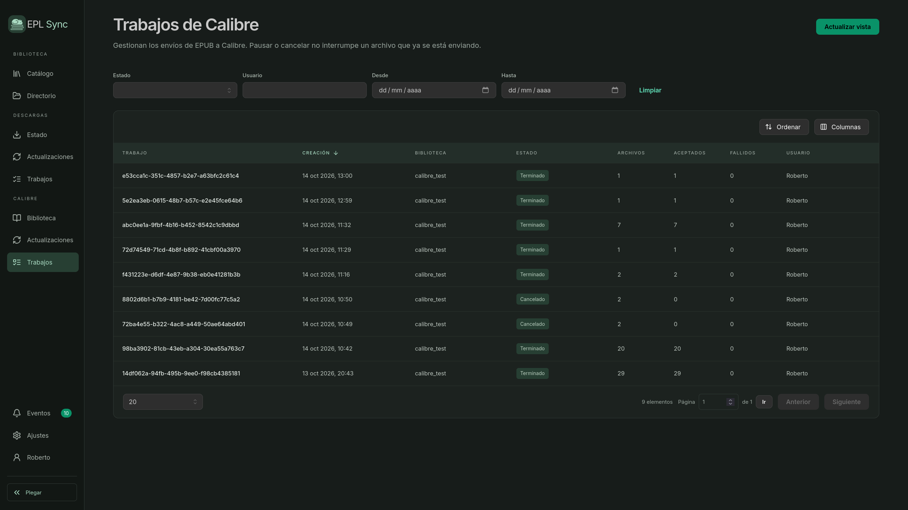</a>
      <br><sub>Trabajos de Calibre</sub>
    </td>
  </tr>
  <tr>
    <td align="center" width="33%">
      <a href="docs/media/screenshots/Eventos.png">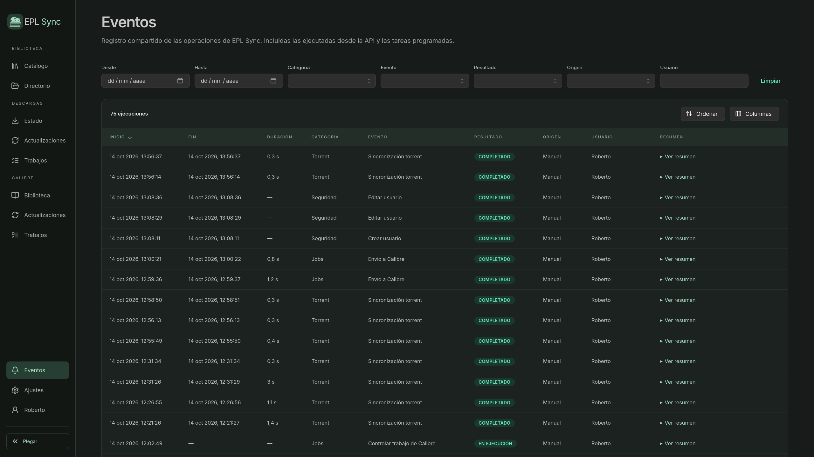</a>
      <br><sub>Eventos</sub>
    </td>
    <td align="center" width="33%">
      <a href="docs/media/screenshots/Ajustes_UsuarioSeguridad.png">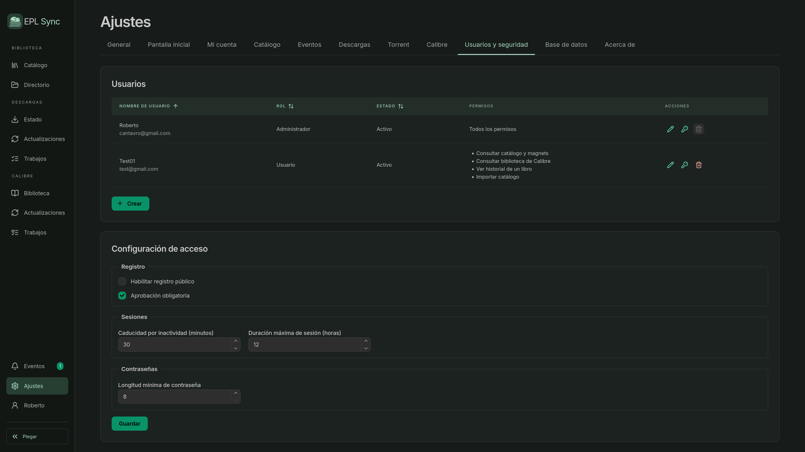</a>
      <br><sub>Usuarios y seguridad</sub>
    </td>
    <td align="center" width="33%">
      <a href="docs/media/screenshots/Ajustes_VerdeClaro.png">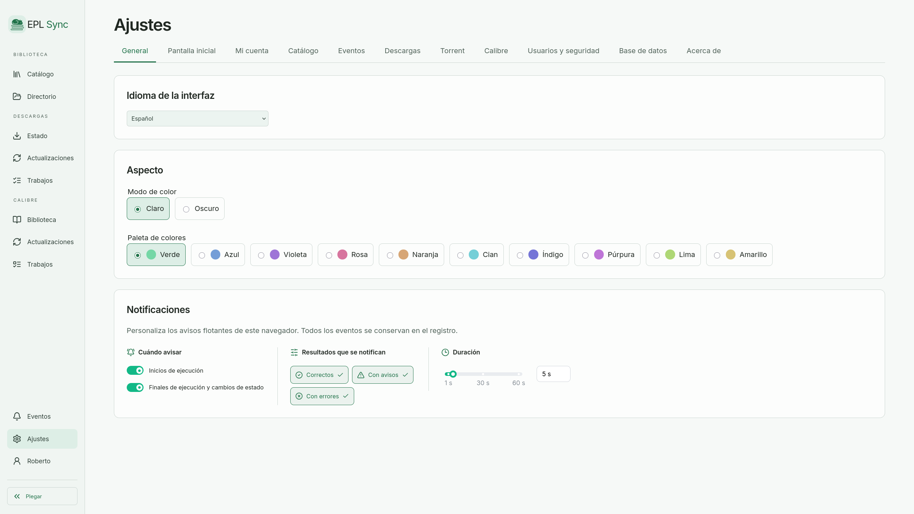</a>
      <br><sub>Ajustes · tema verde claro</sub>
    </td>
  </tr>
</table>

## Contenido

- [Instalación con Docker](#instalación-con-docker)
  - [Requisitos](#1-requisitos)
  - [Prepara la carpeta de instalación](#2-prepara-la-carpeta-de-instalación)
  - [Descarga Docker Compose](#3-descarga-docker-compose)
  - [Configura `.env`](#4-configura-env)
  - [Prepara las carpetas persistentes](#5-prepara-las-carpetas-persistentes)
  - [Inicia EPL Sync](#6-inicia-epl-sync)
- [Ejecutar sin Docker](#ejecutar-sin-docker)
  - [Descarga el JAR y la configuración](#1-descarga-el-jar-y-la-configuración)
  - [Configura la aplicación](#2-configura-la-aplicación)
  - [Inicia EPL Sync](#3-inicia-epl-sync)
  - [Abre la aplicación](#4-abre-la-aplicación)
- [Primer uso](#primer-uso)
- [Actualizar la instalación con Docker](#actualizar-la-instalación-con-docker)
- [Documentación y ayuda](#documentación-y-ayuda)

## Instalación con Docker

### 1. Requisitos

Necesitas Docker y Docker Compose v2. Consulta la
[documentación oficial para instalar Docker](https://docs.docker.com/get-started/get-docker/).

### 2. Prepara la carpeta de instalación

```sh
mkdir -p eplsync
cd eplsync
```

### 3. Descarga Docker Compose

```sh
curl -fsSL https://raw.githubusercontent.com/rlibanez/eplsync/v1.8.1/docker-compose.yml -o docker-compose.yml
```

### 4. Configura `.env`

Después, descarga la plantilla de configuración:

```sh
curl -fsSL https://raw.githubusercontent.com/rlibanez/eplsync/v1.8.1/.env.example -o .env
chmod 600 .env
```

Edita `.env`. Para empezar, revisa estas variables:

| Variable | Descripción | Valor predeterminado |
| --- | --- | --- |
| `EPLSYNC_VERSION` | Versión de la imagen. | `1.8.1` |
| `PUID` | ID del usuario que puede escribir en las carpetas. En Linux, consulta su valor con `id -u`. | `1000` |
| `PGID` | ID del grupo que puede escribir en las carpetas. En Linux, consulta su valor con `id -g`. | `1000` |
| `HOST_PORT` | Puerto publicado. | `8088` |
| `DATA_DIR` | Carpeta persistente de datos. | `./data` |
| `LOGS_DIR` | Carpeta persistente de logs. | `./logs` |
| `TZ` | Zona horaria. | `Europe/Madrid` |
| `EPLSYNC_SECRET_KEY` | Necesaria para guardar credenciales de qBittorrent desde Ajustes. Genera su valor con `openssl rand -base64 32`, cópialo en `.env` y consérvalo. | Sin valor |
| `EPLSYNC_INITIAL_ADMIN_KEY` | Clave opcional para proteger la creación del primer administrador. Genera su valor con `openssl rand -hex 16`. Vacía no exige clave. | Sin valor |

El resto puede conservar sus valores predeterminados, aunque es muy recomendable revisarlos.<br>
Si necesitas personalizar otras opciones, consulta la [tabla de variables](docs/variables-entorno.md).<br>
Los ajustes disponibles en la interfaz pueden configurarse desde **Ajustes**: los valores allí guardados tienen
prioridad sobre los valores iniciales del entorno.<br>
**Importante**: no todas las variables del archivo `.env` se pueden configurar desde **Ajustes**.

### 5. Prepara las carpetas persistentes

```sh
mkdir -p data logs
```

Si has cambiado `DATA_DIR` o `LOGS_DIR`, crea las carpetas correspondientes.
Deben permitir escritura al usuario y grupo indicados en `PUID` y `PGID`.

Para descargar EPUB o enviarlos a Calibre desde el cliente torrent, configura
`TORRENT_DIR` con la carpeta de descargas de qBittorrent en el host y descomenta
su montaje en `docker-compose.yml`. Configura también la carpeta base vista por
qBittorrent en `EPLSYNC_TORRENT_FILES_REMOTE_ROOT` o en Ajustes > Torrent
(por ejemplo, `/downloads`). Definir `TORRENT_DIR` por sí solo no activa el montaje.

### 6. Inicia EPL Sync

```sh
docker compose up -d
```

Abre `http://localhost:8088` o la dirección y puerto que hayas configurado.
Para acceso por red o mediante un proxy HTTPS, consulta la
[guía de acceso y seguridad](docs/seguridad.md#acceso-remoto).

También puedes [instalar EPL Sync como aplicación web (PWA)](docs/instalacion.md#instalar-como-aplicación-pwa)
con un navegador compatible. Requiere HTTPS, salvo en `localhost` o `127.0.0.1`,
y conexión con el servidor; no ofrece funcionamiento sin conexión.

## Ejecutar sin Docker

Se recomienda la instalación mediante Docker. También puedes ejecutar el JAR
directamente en Windows, Linux y macOS.

### 1. Descarga el JAR y la configuración

Instala [Java 25](https://adoptium.net/temurin/releases/?version=25) y descarga
`eplsync-1.8.1.jar` desde los archivos de la
[Release 1.8.1](https://github.com/rlibanez/eplsync/releases/tag/v1.8.1).
El mismo JAR sirve para Windows, Linux y macOS. En macOS, elige Java para
**aarch64** si utilizas Apple Silicon (M1 o posterior) o **x64** si tu Mac es Intel.
Comprueba con `java -version` que la terminal utiliza Java 25.

El JAR incluye la interfaz web y el [controlador SQLite](https://github.com/xerial/sqlite-jdbc), con bibliotecas nativas
para ambas arquitecturas de macOS. No necesitas instalar SQLite, Node.js ni Maven
para ejecutarlo. qBittorrent y el servidor de contenido de Calibre son servicios
opcionales que se configuran por separado.

Guárdalo en una carpeta dedicada a EPL Sync. Incluye el JAR y el
[`application.yaml` correspondiente a esa misma versión](https://raw.githubusercontent.com/rlibanez/eplsync/v1.8.1/backend/src/main/resources/application.yaml), además de las carpetas
`data` y `logs`:

```text
EPL-Sync/
├── eplsync-1.8.1.jar
├── application.yaml
├── data/
└── logs/
```

### 2. Configura la aplicación

Edita el `application.yaml` descargado junto al JAR. Es el mismo archivo utilizado
para construir la aplicación.

Antes de iniciar, revisa estos valores:

- **Acceso local:** añade `address: 127.0.0.1` dentro del apartado `server`, con la
  misma indentación que `port`. Sin esa opción, escucha en todas las interfaces.
- **qBittorrent:** si está en el mismo equipo, cambia `eplsync.torrent.base-url` a
  `"http://localhost:8080"`. También puedes configurarlo desde **Ajustes → Torrent**.
- **Clave de cifrado:** para guardar credenciales desde Ajustes, configura
  `eplsync.security.secret-key`. La interfaz permite generar una clave; cópiala
  en este archivo y reinicia la aplicación.
- **Clave inicial:** `eplsync.security.initial-admin-key` es opcional y protege la
  creación del primer administrador.

Para descargar EPUB desde la interfaz, enviarlos a Calibre o completar sus
identificadores, EPL Sync necesita leer los archivos descargados por qBittorrent.
Configura `eplsync.torrent.files.remote-root` con la raíz que comunica el cliente
y `eplsync.torrent.files.local-root` con la carpeta equivalente accesible desde
EPL Sync. Si ambos se ejecutan directamente en el mismo Mac, pueden ser la misma
ruta, por ejemplo `/Users/tuusuario/Downloads/Libros`. Si qBittorrent está en Docker,
la raíz remota puede ser `/downloads` y la local la carpeta compartida del Mac.
Estas rutas y sus permisos se explican en la [guía de Calibre](docs/calibre.md).

Guarda `data/` en almacenamiento local y concede al usuario que ejecuta Java
permisos de escritura en la carpeta de EPL Sync y de lectura en la carpeta de
EPUB. En macOS, autoriza el acceso de Terminal a Descargas o a los volúmenes
utilizados si el sistema lo solicita.

Las expresiones como `${EPLSYNC_SECRET_KEY:}` permiten utilizar variables del
entorno. Para configurar una clave directamente en el archivo, sustituye toda
la expresión por el valor entre comillas, por ejemplo `secret-key: "CLAVE_GENERADA"`.
Conserva la configuración y no compartas sus claves.

### 3. Inicia EPL Sync

Abre una terminal en la carpeta del JAR y ejecuta en Windows, Linux o macOS:

```sh
java --enable-native-access=ALL-UNNAMED -jar eplsync-1.8.1.jar --spring.config.additional-location=file:./application.yaml
```

El comando carga el archivo externo de configuración. En esta modalidad no se
utiliza el archivo `.env` de Docker Compose.

### 4. Abre la aplicación

Accede a **http://localhost:8088** y sigue los pasos de [Primer uso](#primer-uso).
Mantén la terminal abierta. Para detener EPL Sync, pulsa **Ctrl+C**.

Para actualizar, detén la aplicación y descarga el paquete de la nueva Release.
Sustituye el JAR y adapta su nombre en el comando de arranque. Conserva `data/`,
`logs/` y tu configuración; revisa el YAML de la nueva versión para incorporar
las opciones nuevas sin perder tus claves ni valores personalizados. Los ajustes
guardados desde la interfaz tienen prioridad.

## Primer uso

1. Abre `http://localhost:8088` o la dirección y puerto que hayas configurado.
2. Crea el administrador con nombre de usuario, contraseña y confirmación.
   Si está configurada, introduce también la clave `EPLSYNC_INITIAL_ADMIN_KEY`
   en el mismo formulario; no se solicita correo electrónico.
3. Sigue el asistente para importar el Catálogo, configurar y sincronizar
   qBittorrent y conectar la biblioteca de Calibre. Torrent y Calibre son
   opcionales: puedes omitirlos.

Puedes continuar más tarde y retomar el asistente desde
**Ajustes → General → Abrir asistente de configuración**. Solo se abre
automáticamente en instalaciones nuevas; una actualización no lo activa.

## Actualizar la instalación con Docker

Cambia `EPLSYNC_VERSION` en `.env` a la versión que quieras instalar y ejecuta:

```sh
docker compose pull
docker compose up -d
```

Conserva las carpetas persistentes y el valor de `EPLSYNC_SECRET_KEY`.
Puedes consultar la versión instalada y buscar actualizaciones en
**Ajustes → Acerca de**.

## Documentación y ayuda

- [Guías de uso](docs/README.md).
